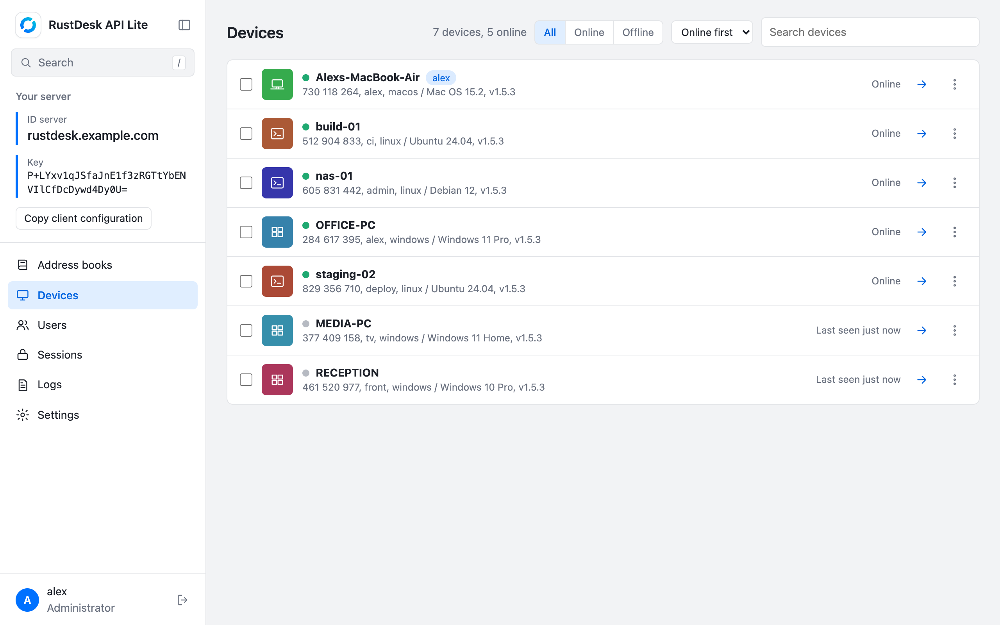
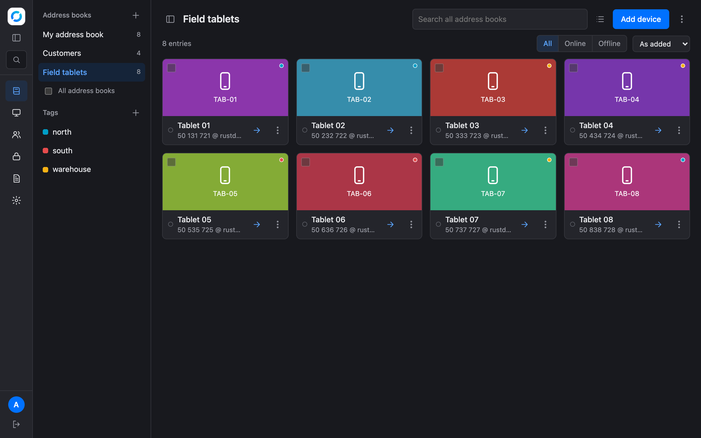
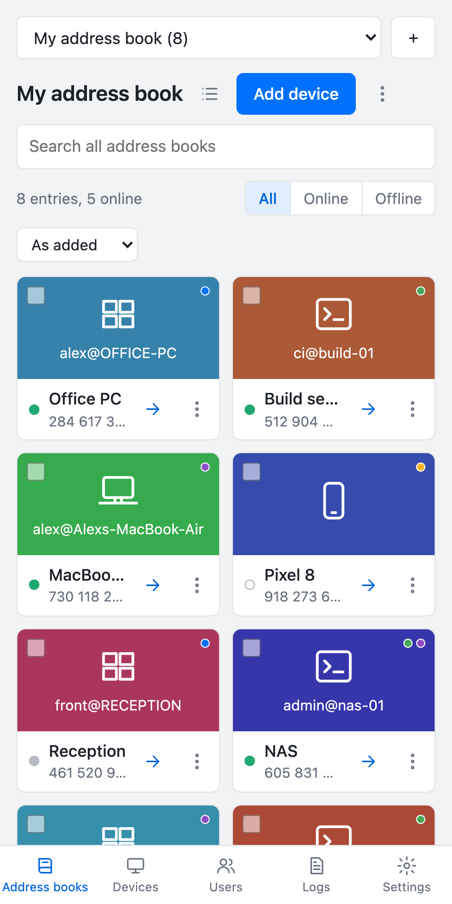

# RustDesk API Lite

[](https://github.com/onatakduman/rustdesk-api-lite/releases/latest)
[](https://github.com/onatakduman/rustdesk-api-lite/actions/workflows/ci.yml)
[](LICENSE)

Accounts, address books and a web console for self-hosted
[RustDesk](https://github.com/rustdesk/rustdesk). It gives the open-source
`hbbs`/`hbbr` pair the part they do not include: sign-in from the RustDesk app,
address books that sync between your devices, a device list and a connection
log, with a console that looks and works like the RustDesk app.

One static binary, one SQLite file, about 15 MB of memory. No Docker, no
Node, no external database.


An independent project, not affiliated with or endorsed by RustDesk
([details](#license-and-trademarks)). The screenshots show made-up data.

## Features

**For the RustDesk app**

- Sign-in with a password, an authenticator code (two-step sign-in), any
  OpenID Connect provider (Google, …) or GitHub
- A personal address book per user and shared ones with view, edit and
  full-control rights for people or whole groups; tags with colours, aliases,
  notes and a default password per shared book
- Works with the current clients and with the single-blob protocol of old ones
- Device groups: in a shared group the members see each other's devices
- Entries on other servers: an entry can carry its own server and key
  (`123456789@host?key=…`), so one address book reaches several fleets
- `rustdesk --assign --token …`, and enrolment of custom clients through their
  `preset-*` options (off by default)

**In the console**

- One search over every address book you can read and over the devices
  (`/` or Ctrl/Cmd+K from any page)
- Filters for online and offline, sorting, tiles or a list with columns
- Online state for every entry, asked from the entry's own ID server, also
  for entries on other servers
- Connect in the RustDesk app with a double-click; the menu also opens file
  transfer, camera, terminal, TCP tunnel, RDP or a session through the relay
- Batch work: select entries or devices to tag, copy, add to a book, remove
  or forget them; export a book as CSV
- English and Turkish, light and dark, usable on a phone; both side panels
  fold away; date format and time zone are your choice

**For the administrator**

- Devices with host name, OS, version, owner, group and live sessions; end a
  session, set owner and group, push client options to every device
- Logs: who connected to which device and when (with the note written at the
  end of a session), file transfers, sign-ins and the security alarms devices
  report
- Users, groups, signed-in apps and browsers, API tokens for scripts
- The administration commands of hbbs and hbbr (relay list, block lists,
  bandwidth limits, …) from the console when they run on the same machine
- A command line for accounts, tokens and shares
- Import from [lejianwen/rustdesk-api](https://github.com/lejianwen/rustdesk-api)
  that keeps signed-in clients signed in

Not included: session recording, LDAP, e-mail verification codes, fixed-ID
deployment (`rustdesk --deploy`, needs the rendezvous server's cooperation).
`docs/client-api-contract.md` lists everything the client can call.

## Screenshots

| | |
|---|---|
|  |  |
| One search over every address book. The menu opens the device in the RustDesk app. | Devices that report to the server. |
|  |  |
| Dark, with the side panel folded to a rail. | On a phone. |

## Install

### Linux with systemd, in one line

```sh
curl -fsSL https://raw.githubusercontent.com/onatakduman/rustdesk-api-lite/main/install.sh | sudo sh
```

The [script](install.sh) downloads the latest release for your CPU (x86-64 or
ARM64), checks its checksum, installs the binary to `/usr/local/bin`, creates
a service user and starts the service on `127.0.0.1:21114`. Run it again to
upgrade; the database and your service file are left alone. Set
`RDL_VERSION=v0.1.0` to install a particular release.

### From a release archive

Archives for Linux, macOS and Windows are on the
[releases page](https://github.com/onatakduman/rustdesk-api-lite/releases/latest),
with a `SHA256SUMS` file.

```sh
tar -xzf rustdesk-api-lite-linux-amd64.tar.gz
./rustdesk-api-lite-linux-amd64/rustdesk-api-lite serve
```

The Linux archives also hold the systemd unit and the install script.

### From source

```sh
go build -o rustdesk-api-lite .
./rustdesk-api-lite serve
```

## First steps

1. The first start creates the account `admin` and prints its password once
   (with the service: `journalctl -u rustdesk-api-lite | grep 'First start'`).
2. Put a reverse proxy with HTTPS in front of the server (below).
3. Sign in and enter your ID server, relay server and public key under Settings.
4. In the RustDesk app set the API server (Settings → Network → ID/Relay
   server) to the public address, for example `https://rustdesk.example.com`,
   or paste the client configuration the console offers to copy.

### Behind Caddy

```
rustdesk.example.com {
    reverse_proxy 127.0.0.1:21114
}
```

Run with `-trust-proxy` (or `RDL_TRUST_PROXY=1`, which the systemd unit sets)
so the real client address is used for throttling and logs.

### Options

| Flag | Environment | Default | |
|---|---|---|---|
| `-db` | `RDL_DB` | `./data/rustdesk-api-lite.db` | database file |
| `-listen` | `RDL_LISTEN` | `127.0.0.1:21114` | listen address |
| `-trust-proxy` | `RDL_TRUST_PROXY` | off | trust `X-Forwarded-*` |

`RDL_PUBLIC_URL`, `RDL_ID_SERVER`, `RDL_RELAY_SERVER` and `RDL_KEY` seed the
settings on the first start; later they are edited in the console. With the
systemd unit the database is `/var/lib/rustdesk-api-lite/rustdesk-api-lite.db`.

### Command line

```
rustdesk-api-lite user add alice -admin     # password is read from stdin
rustdesk-api-lite user passwd alice
rustdesk-api-lite user list
rustdesk-api-lite token add alice "nightly sync"   # an API token for scripts, printed once
rustdesk-api-lite share "Field" alice edit        # view | edit | full | none
rustdesk-api-lite version
```

With the service installed, run these as the service user and against its
database:

```sh
sudo -u rustdesk-api-lite rustdesk-api-lite user list -db /var/lib/rustdesk-api-lite/rustdesk-api-lite.db
```

### Uninstall

```sh
sudo systemctl disable --now rustdesk-api-lite
sudo rm /usr/local/bin/rustdesk-api-lite /etc/systemd/system/rustdesk-api-lite.service
sudo userdel rustdesk-api-lite
```

The data stays in `/var/lib/rustdesk-api-lite` until you remove that folder.

## Moving from lejianwen/rustdesk-api

```
rustdesk-api-lite import-lejianwen /path/to/rustdeskapi.db
```

Run it as the service user and against the service database (`-db …`) when
the server is installed with the systemd unit; take a copy of the source
database first if the old server is still running.

The source database is opened read-only. The import can be repeated: accounts
are matched by user name, imported address books are replaced with the source
content, the connection log continues where the last run stopped. Register the
redirect address shown under Settings → Sign-in providers at your provider; the
path `/api/oidc/callback` is the same as before.

## Security notes

- Passwords are stored as bcrypt hashes, session tokens as SHA-256 hashes.
- Sign-in is throttled per address and per account.
- The console uses an HttpOnly cookie; changes need a same-origin request.
- Device reports (heartbeat, system information, audit) are unauthenticated by
  design of the RustDesk client. A device ID is bound to the first UUID that
  reports it; reports with another UUID are ignored.
- For the online state the server connects to the ID servers named in
  address-book entries. Only public addresses are asked, apart from your own
  ID server, and the lookups can be switched off in the settings.
- Serve it over HTTPS. The RustDesk app sends the session token on every call.

## Development

```
make test
make linux      # static linux/amd64 and linux/arm64 binaries in dist/
make release    # archives for every platform and SHA256SUMS in dist/
```

The console is plain HTML, CSS and JavaScript in `web/`, embedded into the
binary. There is no build step.

Releases follow [semantic versioning](https://semver.org). Pushing a tag such
as `v0.2.0` builds the archives and publishes the release with the matching
section of [CHANGELOG.md](CHANGELOG.md) as its notes.

## License and trademarks

MIT, see [LICENSE](LICENSE).

"RustDesk" and the RustDesk logo are trademarks of their owner. The console
shows the logo (`web/icon.svg`, taken unchanged from the RustDesk project)
only to say which software it is a companion to; that file is not covered by
this project's MIT license.
