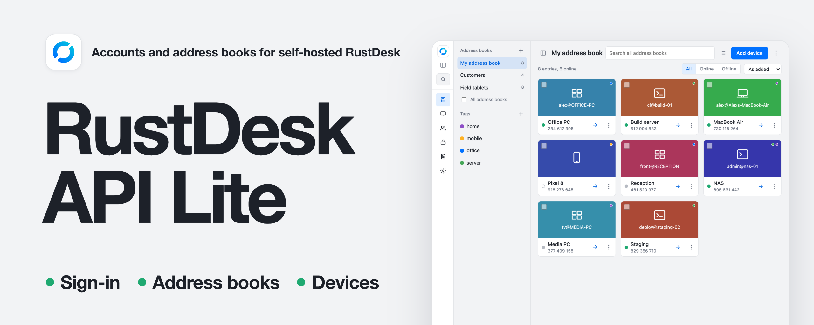
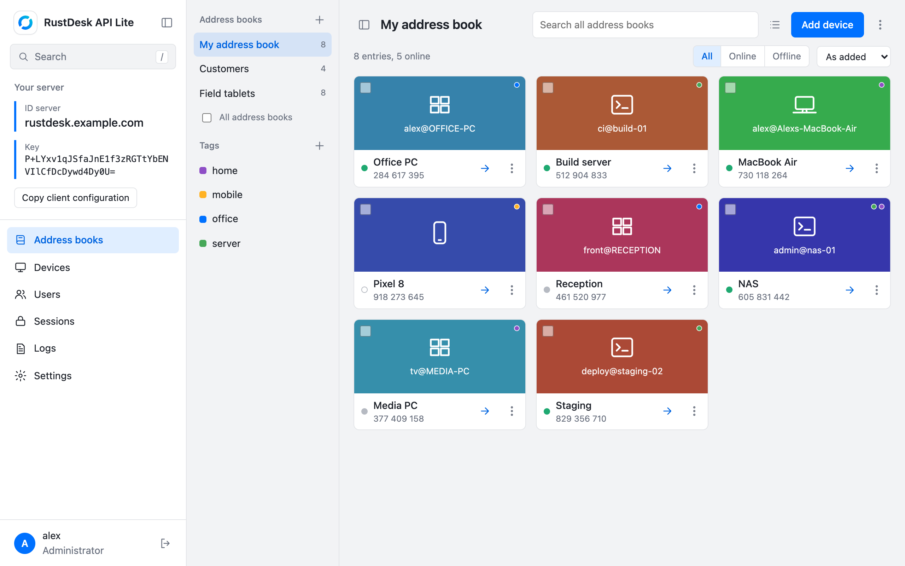
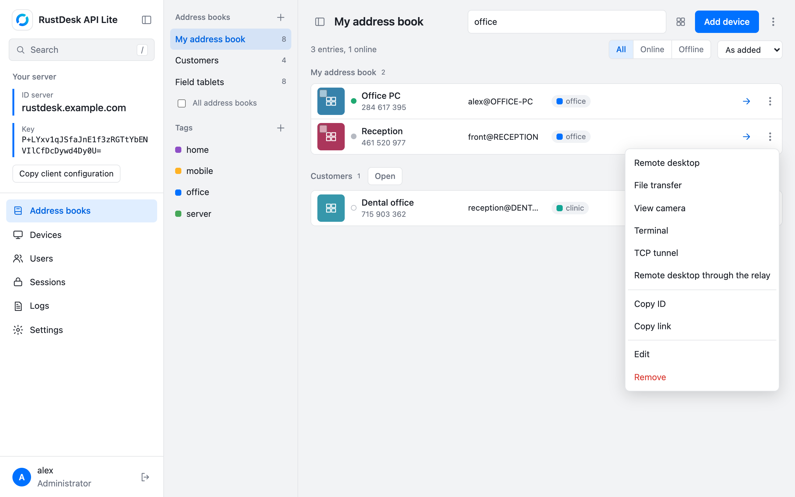

# RustDesk API Lite

[](https://github.com/onatakduman/rustdesk-api-lite/actions/workflows/ci.yml)
[](https://github.com/onatakduman/rustdesk-api-lite/releases/latest)
[](LICENSE)

Accounts, address books and a web console for self-hosted
[RustDesk](https://github.com/rustdesk/rustdesk). It gives the open-source
`hbbs`/`hbbr` pair the part they do not include: sign-in from the RustDesk app,
address books that sync between your devices, a device list and a connection
log, with a console that looks and works like the RustDesk app.

One static binary, one SQLite file, about 15 MB of memory. No Node, no
external database, Docker only if you want it.

An independent project, not affiliated with or endorsed by RustDesk
([details](#license-and-trademarks)). The screenshots show made-up data.

## Features

**For the RustDesk app**

- Sign-in with a password, an authenticator code (two-step sign-in), any
  OpenID Connect provider (Google, …) or GitHub
- A personal address book per user and shared ones with view, edit and
  full-control rights for people or whole groups; tags with colours, aliases,
  notes and a default password per shared book
- Works with the current clients and with the single-blob protocol of old ones
- Device groups: in a shared group the members see each other's devices
- Entries on other servers: an entry can carry its own server and key
  (`123456789@host?key=…`), so one address book reaches several fleets
- `rustdesk --assign --token …`, and enrolment of custom clients through their
  `preset-*` options (off by default)

**In the console**

- One search over every address book you can read and over the devices
  (`/` or Ctrl/Cmd+K from any page)
- Filters for online and offline, sorting, tiles or a list with columns
- Online state for every entry, asked from the entry's own ID server, also
  for entries on other servers
- Connect in the RustDesk app with a double-click; the menu also opens file
  transfer, camera, terminal, TCP tunnel, RDP or a session through the relay
- Batch work: select entries or devices to tag, copy, add to a book, remove
  or forget them; export a book as CSV
- English and Turkish, light and dark, usable on a phone; both side panels
  fold away; date format and time zone are your choice

**For the administrator**

- Devices with host name, OS, version, owner, group and live sessions; end a
  session, set owner and group, push client options to every device
- Logs: who connected to which device and when (with the note written at the
  end of a session), file transfers, sign-ins and the security alarms devices
  report
- Users, groups, signed-in apps and browsers, API tokens for scripts
- The administration commands of hbbs and hbbr (relay list, block lists,
  bandwidth limits, …) from the console when they run on the same machine
- A command line for accounts, tokens, shares and settings
- An install that asks no questions, for people, scripts and AI agents

Not included: session recording, LDAP, e-mail verification codes, fixed-ID
deployment (`rustdesk --deploy`, needs the rendezvous server's cooperation).
`docs/client-api-contract.md` lists everything the client can call.

## Screenshots



| | |
|---|---|
|  |  |
| One search over every address book. The menu opens the device in the RustDesk app. | Devices that report to the server. |
|  |  |
| Dark, with the side panel folded to a rail. | On a phone. |

## Install

### Linux with systemd, in one line

```sh
curl -fsSL https://raw.githubusercontent.com/onatakduman/rustdesk-api-lite/main/install.sh | sudo sh
```

The [script](install.sh) downloads the latest release for your CPU (x86-64 or
ARM64), checks its checksum, installs the binary to `/usr/local/bin`, creates
a service user and starts the service on `127.0.0.1:21114`. It asks nothing
and prints the admin password of the first start. Run it again to upgrade; the
database, your settings and your service file are left alone.

### Unattended, for scripts and AI agents

Give the server its settings up front and read the result from the last lines:

```sh
curl -fsSL https://raw.githubusercontent.com/onatakduman/rustdesk-api-lite/main/install.sh | sudo \
  RDL_PUBLIC_URL=https://rustdesk.example.com \
  RDL_ID_SERVER=rustdesk.example.com \
  RDL_RELAY_SERVER=rustdesk.example.com \
  RDL_KEY="$(cat /var/lib/rustdesk/id_ed25519.pub)" \
  sh
```

```
status=installed
version=v0.1.2
url=http://127.0.0.1:21114
health=http://127.0.0.1:21114/healthz
service=rustdesk-api-lite
settings=/etc/rustdesk-api-lite.env
admin_user=admin
admin_password=…
```

`status` is `installed`, `upgraded`, `uninstalled` or `failed`, and the exit
code is non-zero on failure. `RDL_VERSION=v0.1.2` pins a release and
`RDL_LISTEN` moves the port. [AGENTS.md](AGENTS.md) has the whole procedure
for an agent, from picking the method to handing over the client configuration.

### With Docker

```sh
docker run -d --name rustdesk-api-lite --restart unless-stopped \
  -p 127.0.0.1:21114:21114 -v rustdesk-api-lite:/data \
  ghcr.io/onatakduman/rustdesk-api-lite
docker logs rustdesk-api-lite 2>&1 | grep 'First start'     # the admin password
```

Every release is published as an image for x86-64 and ARM64. `latest` is the
newest release; a tag such as `:v0.1.2` pins one. To upgrade, pull the image
and create the container again; the data stays in the volume. The `RDL_*`
settings below work as `-e` options.

To build the image yourself instead:

```sh
docker build -t rustdesk-api-lite https://github.com/onatakduman/rustdesk-api-lite.git#v0.1.2
```

### From a release archive

Archives for Linux, macOS and Windows are on the
[releases page](https://github.com/onatakduman/rustdesk-api-lite/releases/latest),
with a `SHA256SUMS` file.

```sh
tar -xzf rustdesk-api-lite-linux-amd64.tar.gz
./rustdesk-api-lite-linux-amd64/rustdesk-api-lite serve
```

### From source

```sh
go build -o rustdesk-api-lite .
./rustdesk-api-lite serve
```

## First steps

1. The first start creates the account `admin` and prints its password once.
   The install script shows it; otherwise look in the log
   (`journalctl -u rustdesk-api-lite | grep 'First start'`).
2. Put a reverse proxy with HTTPS in front of the server (below).
3. Sign in and enter your ID server, relay server and public key under
   Settings, unless the install already set them.
4. In the RustDesk app set the API server (Settings → Network → ID/Relay
   server) to the public address, for example `https://rustdesk.example.com`,
   or import the client configuration that the console and
   `rustdesk-api-lite config` show.

### Behind Caddy

```
rustdesk.example.com {
    reverse_proxy 127.0.0.1:21114
}
```

Run with `-trust-proxy` (or `RDL_TRUST_PROXY=1`, which the systemd unit and
the Docker image set) so the real client address is used for throttling and logs.

### Options

| Flag | Environment | Default | |
|---|---|---|---|
| `-db` | `RDL_DB` | `./data/rustdesk-api-lite.db` | database file |
| `-listen` | `RDL_LISTEN` | `127.0.0.1:21114` | listen address |
| `-trust-proxy` | `RDL_TRUST_PROXY` | off | trust `X-Forwarded-*` |

`RDL_PUBLIC_URL`, `RDL_ID_SERVER`, `RDL_RELAY_SERVER` and `RDL_KEY` fill the
settings on the first start; later they are changed in the console or with
`config set`. With the systemd unit the database is
`/var/lib/rustdesk-api-lite/rustdesk-api-lite.db` and local settings live in
`/etc/rustdesk-api-lite.env`. `GET /healthz` answers when the server is up.

### Command line

```
rustdesk-api-lite user add alice -admin     # password is read from stdin
rustdesk-api-lite user passwd alice
rustdesk-api-lite user list
rustdesk-api-lite token add alice "nightly sync"   # an API token for scripts, printed once
rustdesk-api-lite share "Field" alice edit        # view | edit | full | none
rustdesk-api-lite config                           # settings and the client configuration string
rustdesk-api-lite config set id-server rustdesk.example.com
rustdesk-api-lite version
```

With the service installed, run these as the service user and against its
database:

```sh
sudo -u rustdesk-api-lite rustdesk-api-lite config -db /var/lib/rustdesk-api-lite/rustdesk-api-lite.db
```

### Uninstall

```sh
curl -fsSL https://raw.githubusercontent.com/onatakduman/rustdesk-api-lite/main/install.sh | sudo sh -s -- uninstall
```

The data stays in `/var/lib/rustdesk-api-lite` and the settings in
`/etc/rustdesk-api-lite.env` until you remove them.

## Security notes

- Passwords are stored as bcrypt hashes, session tokens as SHA-256 hashes.
- Sign-in is throttled per address and per account.
- The console uses an HttpOnly cookie; changes need a same-origin request.
- Device reports (heartbeat, system information, audit) are unauthenticated by
  design of the RustDesk client. A device ID is bound to the first UUID that
  reports it; reports with another UUID are ignored.
- For the online state the server connects to the ID servers named in
  address-book entries. Only public addresses are asked, apart from your own
  ID server, and the lookups can be switched off in the settings.
- Serve it over HTTPS. The RustDesk app sends the session token on every call.

## Development

```
make test
make linux      # static linux/amd64 and linux/arm64 binaries in dist/
make release    # archives for every platform and SHA256SUMS in dist/
```

The console is plain HTML, CSS and JavaScript in `web/`, embedded into the
binary. There is no build step.

Releases follow [semantic versioning](https://semver.org). Pushing a tag such
as `v0.2.0` builds the archives and publishes the release with the matching
section of [CHANGELOG.md](CHANGELOG.md) as its notes.

## References

Projects this one was built against or learned from:

- [RustDesk](https://github.com/rustdesk/rustdesk), the app whose API this
  server answers. `docs/client-api-contract.md` was written from its source.
- [rustdesk-server](https://github.com/rustdesk/rustdesk-server), the ID and
  relay servers (hbbs, hbbr) this runs next to; the online query and the
  server commands speak their protocols.
- [lejianwen/rustdesk-api](https://github.com/lejianwen/rustdesk-api), the
  API server this project started as a replacement for. An installation of it
  can be brought over: [docs/migrating-from-lejianwen.md](docs/migrating-from-lejianwen.md).

## License and trademarks

MIT, see [LICENSE](LICENSE).

"RustDesk" and the RustDesk logo are trademarks of their owner. The console
shows the logo (`web/icon.svg`, taken unchanged from the RustDesk project)
only to say which software it is a companion to; that file is not covered by
this project's MIT license.
